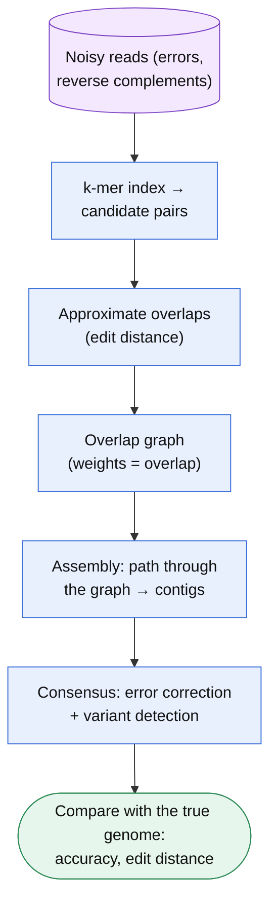
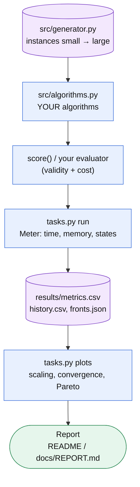

# VSI chat pack — DNA Genome Reconstruction from Noisy Sequencing Reads

> **For students using ChatGPT, Gemini or Claude in the browser or the app.**
> Upload this file to the chat and write: *"Read this file and guide me step by step."*
> SQ: Ngarkoje këtë skedar në chat dhe shkruaj: *"Lexo këtë skedar dhe më udhëhiq hap pas hapi."*

Project id (slug): `dna-genome-reconstruction` · Source: professor brief (see PROBLEM.md)

## Instructions for the AI (read this first, follow it the whole conversation)

You are helping a university student with an **Algorithm Design & Analysis** project. The student may be a
beginner. **Reply in the student's language** (often Albanian). You cannot see their computer, so:

1. Work in **small steps**. Give the exact commands to copy, then **wait** for the student to paste the output.
2. Before the first command, ask which system they use. Use `python` on **Windows** and `python3` on
   **macOS / Linux** in every command you give.
3. When you write code, give the **complete content of one file** and its path (e.g. `src/algorithms.py`),
   never fragments to merge. After every change the student runs `python tasks.py test`.
4. The algorithms are the **student's own work**: explain the idea, pseudocode and complexity, keep the code
   simple and commented, and check they understand it (they must defend it in front of the professor).
   Do not import solver / optimisation libraries for the core algorithm.
5. Never invent results. Numbers in the report come from `results/metrics.csv`.

### Step 1 — set up the project (once)
1. Python 3.10 or newer: `python --version` (Windows) / `python3 --version` (macOS, Linux).
   If it is missing or older: install it from https://www.python.org/downloads/ (Windows: tick "Add to PATH").
2. Download VSI: https://github.com/andikuqi/vsi → **Code → Download ZIP**, unzip it.
3. Copy the folder **`vsi`** and the file **`AGENTS.md`** into the student's project folder
   (an empty folder or their existing GitHub repo).
4. Open a terminal **in the project folder** (Windows: in the folder, type `cmd` in the address bar and press
   Enter; macOS: right-click the folder → New Terminal at Folder; Linux: right-click → Open in Terminal) and run:
   ```
   python -m vsi new dna-genome-reconstruction . --force
   python tasks.py start
   ```
   (`python3` instead of `python` on macOS / Linux.) `start` installs what is needed, downloads the data,
   runs the tests and a first run, makes charts, starts the report and prints **progress + the next step**.
   Ask the student to paste that output, then explain it in a few simple sentences.

### Step 2 — every work session
1. The student runs `python tasks.py context` and uploads the new **`CONTEXT.md`** (their current code,
   progress and results) to this chat.
2. Take the **next step** it shows (first open requirement), explain it, write the code, then:
   `python tasks.py test` → tick the requirement in `docs/REQUIREMENTS.md` → `python tasks.py report`.
3. Useful commands: `python tasks.py run` (experiments), `python tasks.py plots` (charts),
   `python tasks.py check` (progress + next step).

---

## The project (docs/PROBLEM.md)

## DNA Genome Reconstruction from Noisy Sequencing Reads

Source: professor's brief (condensed here; keep the original brief next to this file if you have it).

### Goal
Reconstruct an unknown DNA sequence from many short, unordered, noisy reads. Reads may overlap, contain
substitutions/insertions/deletions, be duplicated, and appear forward or as reverse complement.
Minimise time and memory while maximising reconstruction accuracy.

### Required components
1. Efficient overlap detection between reads.
2. Indexing (k-mer hashing, suffix arrays/trees, inverted index) to avoid all-pairs O(n²) comparison.
3. Overlap graph: reads = nodes, overlaps = weighted directed edges (quality / length / confidence).
4. Reconstruction by traversing/simplifying the graph (greedy, graph optimisation, DP, own method).
5. Error handling with approximate matching / edit distance (local or banded alignment).
6. Consensus building, error correction, detection of mutations (substitutions, insertions, deletions).
7. Scalability evaluation on growing datasets (thousands → hundreds of thousands of reads).

### Input
Reads (varying lengths), optional quality scores, parameters: minimum overlap, allowed error rate, k-mer size.

### Output
Reconstructed sequence; variant/mutation report; statistics: reads used, overlaps found, average overlap
quality, reconstruction length, execution time, memory.

### Metrics
Accuracy vs reference, edit distance to the original, correctly detected mutations, % reads incorporated,
time, memory, number of candidate read comparisons, scalability.

### Challenges
Avoiding O(n²); noise vs real mutations; huge overlap graphs; choosing k and thresholds; repeats;
accuracy vs resources.

### VSI starter
`src/generator.py` simulates a reference genome and noisy reads (with known truth, so accuracy can be measured).

---

## Diagrams

### Problem model



### Project pipeline



---

## Requirements checklist (docs/REQUIREMENTS.md)

## Requirements checklist

### Implementation
- [ ] Read simulator / dataset loader (small, medium, large) <!-- auto:data -->
- [ ] Indexing technique (k-mer hash / suffix array / inverted index) for candidate pairs
- [ ] Approximate overlap detection (edit distance / banded alignment)
- [ ] Overlap graph construction with edge weights
- [ ] Reconstruction algorithm (greedy / graph-based / DP / own)
- [ ] Reverse-complement handling
- [ ] Error correction via consensus
- [ ] Variant / mutation detection report
- [ ] At least one idea designed or modified by us (DECISIONS.md)

### Analysis
- [ ] Pseudocode for every algorithm
- [ ] Time & space complexity for every algorithm
- [ ] Discussion: how indexing avoids O(n²); repeats; k-mer and threshold choice

### Experiments
- [ ] Metrics: accuracy, edit distance, % reads used, comparisons, time, memory
- [ ] Scaling experiment (reads: thousands → hundreds of thousands)
- [ ] Comparison of at least two approaches / parameter settings
- [ ] Graphs and tables in README

### Delivery
- [ ] README report complete
- [ ] Defense preparation
