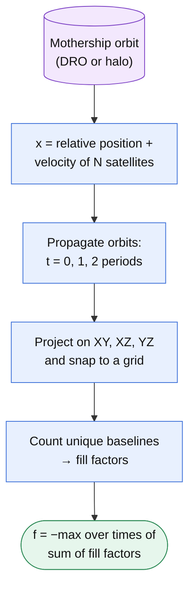
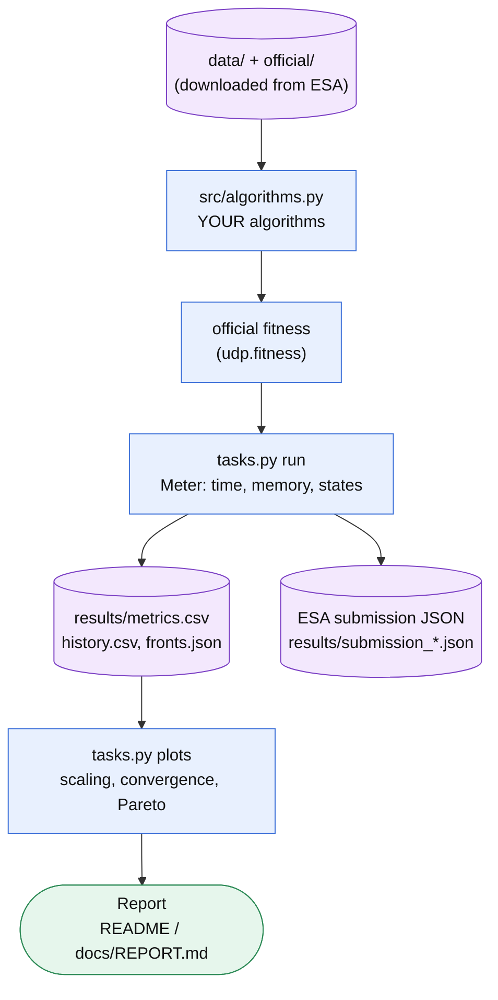

# VSI chat pack — Interferometric Mission

> **For students using ChatGPT, Gemini or Claude in the browser or the app.**
> Upload this file to the chat and write: *"Read this file and guide me step by step."*
> SQ: Ngarkoje këtë skedar në chat dhe shkruaj: *"Lexo këtë skedar dhe më udhëhiq hap pas hapi."*

Project id (slug): `interferometric-mission` · Source: https://optimise.esa.int/challenge/spoc-3-interferometric-mission/About

## Instructions for the AI (read this first, follow it the whole conversation)

You are helping a university student with an **Algorithm Design & Analysis** project. The student may be a
beginner. **Reply in the student's language** (often Albanian). You cannot see their computer, so:

1. Work in **small steps**. Give the exact commands to copy, then **wait** for the student to paste the output.
2. Before the first command, ask which system they use. Use `python` on **Windows** and `python3` on
   **macOS / Linux** in every command you give.
3. When you write code, give the **complete content of one file** and its path (e.g. `src/algorithms.py`),
   never fragments to merge. After every change the student runs `python tasks.py test`.
4. The algorithms are the **student's own work**: explain the idea, pseudocode and complexity, keep the code
   simple and commented, and check they understand it (they must defend it in front of the professor).
   Do not import solver / optimisation libraries for the core algorithm.
5. Never invent results. Numbers in the report come from `results/metrics.csv`.

### Step 1 — set up the project (once)
1. Python 3.10 or newer: `python --version` (Windows) / `python3 --version` (macOS, Linux).
   If it is missing or older: install it from https://www.python.org/downloads/ (Windows: tick "Add to PATH").
2. Download VSI: https://github.com/andikuqi/vsi → **Code → Download ZIP**, unzip it.
3. Copy the folder **`vsi`** and the file **`AGENTS.md`** into the student's project folder
   (an empty folder or their existing GitHub repo).
4. Open a terminal **in the project folder** (Windows: in the folder, type `cmd` in the address bar and press
   Enter; macOS: right-click the folder → New Terminal at Folder; Linux: right-click → Open in Terminal) and run:
   ```
   python -m vsi new interferometric-mission . --force
   python tasks.py start
   ```
   (`python3` instead of `python` on macOS / Linux.) `start` installs what is needed, downloads the data,
   runs the tests and a first run, makes charts, starts the report and prints **progress + the next step**.
   Ask the student to paste that output, then explain it in a few simple sentences.

### Step 2 — every work session
1. The student runs `python tasks.py context` and uploads the new **`CONTEXT.md`** (their current code,
   progress and results) to this chat.
2. Take the **next step** it shows (first open requirement), explain it, write the code, then:
   `python tasks.py test` → tick the requirement in `docs/REQUIREMENTS.md` → `python tasks.py report`.
3. Useful commands: `python tasks.py run` (experiments), `python tasks.py plots` (charts),
   `python tasks.py check` (progress + next step).

---

## The project (docs/PROBLEM.md)

## Problem: ESA SpOC 3 — Interferometric Mission

Source: https://optimise.esa.int/challenge/spoc-3-interferometric-mission/About
Official code (UDP, tutorial notebook): https://github.com/esa/SpOC3/tree/main/Challenge%202%20Interferometric%20Mission
Single-objective · continuous · GECCO 2024.

### Story in one line
Place satellites around a "mothership" so that, seen from three directions and at three moments,
they form as many **distinct baselines** (pairwise displacements) as possible — a Golomb-ruler-like pattern.

### Problems
| Problem id | Mothership orbit | Satellites N | Grid | Dimension |
|---|---|---|---|---|
| `tiny-observatory-in-dro` | Distant Retrograde Orbit | 5 | 11×11 | 30 |
| `large-observatory-in-dro` | Distant Retrograde Orbit | 40 | 21×21 | 240 |
| `large-observatory-in-halo` | Halo orbit | 40 | 21×21 | 240 |

### Decision vector
Relative initial position and velocity of each satellite w.r.t. the mothership (normalised units):
`x = [dx1..dxN, dy1..dyN, dz1..dzN, dvx1..dvxN, dvy1..dvyN, dvz1..dvzN]` (length 6N).

### Evaluation
- The satellites are propagated (Earth–Moon three-body dynamics) and measured at t = 0, 1 and 2 mothership periods.
- At each time the positions are projected on the XY, XZ and YZ planes and snapped to a square grid centred on the
  mothership. Positions -1 / +1 are the grid edges; satellites outside the grid are ignored.
- After each period the grid grows by the factor 1.23.
- Two satellites in the same grid square count as one.
- For each plane, the **fill factor** grows with the number of unique baselines.

### Objective (minimise)
`f = - max over i in {1,2,3} of ( f_i,XY + f_i,XZ + f_i,YZ )`

### Submission format
JSON file (one decision vector), uploaded at https://optimise.esa.int/submit:
```json
[
  {
    "decisionVector": [ x ],
    "problem": "tiny-observatory-in-dro",
    "challenge": "spoc-3-interferometric-mission"
  }
]
```
Python: `from submission_helper import create_submission` (https://api.optimize.esa.int/data/tools/submission_helper.py), or `vsi.esa.write_submission`.

Problem ids: `tiny-observatory-in-dro`, `large-observatory-in-dro`, `large-observatory-in-halo`.

### Dependencies (official)
`heyoka == 3.2.0` (mandatory — 4.x fails to load the UDP), `pygmo`, `numpy`, `scipy`, `PIL`, `matplotlib`.

### Why it is hard
Maximising distinct pairwise distances is a Golomb-ruler-type combinatorial problem (hard even in 1D), here coupled
with orbital dynamics that move the pattern over time. Each evaluation needs numerical propagation, so evaluations
are expensive: use a fast surrogate (e.g. count baselines at t = 0 only) before the official fitness.

---

## Diagrams

### Problem model



### Project pipeline



---

## Requirements checklist (docs/REQUIREMENTS.md)

## Requirements checklist

Tick a box (`[x]`) only when it is done **and** verified. `python tasks.py check` reads this file.

### Problem & data
- [x] Problem statement copied from the official page (docs/PROBLEM.md)
- [ ] Official data + evaluation code downloaded and wired (`python tasks.py data`) <!-- auto:data -->
- [ ] Official packages installed (heyoka 3.2.0, pygmo) and the official fitness runs
- [ ] Own fast baseline counter (unique baselines on a grid) tested against the official fitness at t = 0
- [ ] Official example / sample solution evaluates to the expected value (test)

### Algorithms
- [ ] Baseline (random search) runs end to end with the official fitness <!-- auto:baseline -->
- [ ] Constructive heuristic (e.g. place satellites on a Golomb-ruler / Costas-array pattern)
- [ ] Improvement method (local search / simulated annealing / CMA-ES / GA)
- [ ] Strategy for keeping the pattern after 1 and 2 periods (velocity choice)
- [ ] At least one idea designed or modified by us (documented in DECISIONS.md)

### Analysis
- [ ] Pseudocode for every algorithm (README)
- [ ] Time & space complexity for every algorithm (README)
- [ ] Why the problem is hard / why heuristics are used

### Experiments
- [ ] Metrics recorded: fitness, runtime, peak memory, fitness evaluations <!-- auto:metrics -->
- [ ] Results on every problem instance
- [ ] Algorithm comparison table
- [ ] Convergence plot (best fitness over time) per problem
- [ ] Theory vs measured performance (scaling discussion)

### Delivery
- [ ] Submission JSON per problem, checked with the official fitness function
- [ ] README report complete (all sections filled)
- [ ] Defense preparation: can explain every algorithm and design decision
