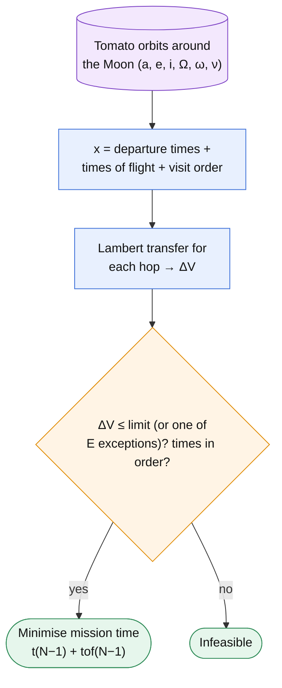
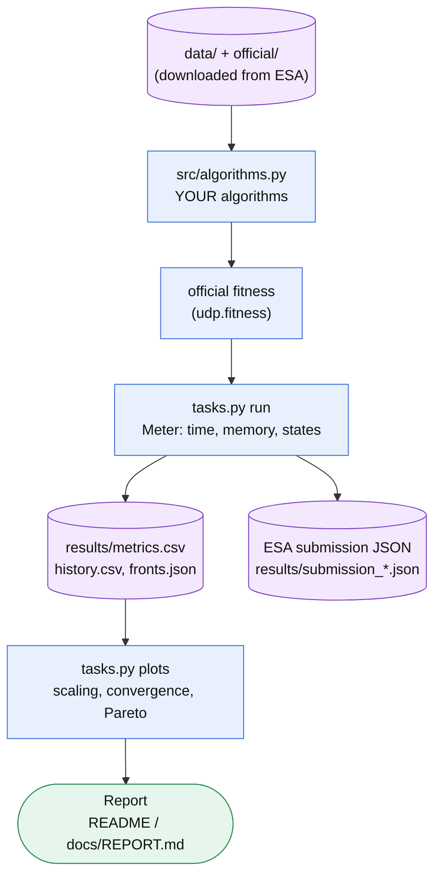

# VSI chat pack — Keplerian Tomato Traveling Salesperson

> **For students using ChatGPT, Gemini or Claude in the browser or the app.**
> Upload this file to the chat and write: *"Read this file and guide me step by step."*
> SQ: Ngarkoje këtë skedar në chat dhe shkruaj: *"Lexo këtë skedar dhe më udhëhiq hap pas hapi."*

Project id (slug): `keplerian-tomato-tsp` · Source: https://optimise.esa.int/challenge/spoc-4-keplerian-tomato-traveling-salesperson/About

## Instructions for the AI (read this first, follow it the whole conversation)

You are helping a university student with an **Algorithm Design & Analysis** project. The student may be a
beginner. **Reply in the student's language** (often Albanian). You cannot see their computer, so:

1. Work in **small steps**. Give the exact commands to copy, then **wait** for the student to paste the output.
2. Before the first command, ask which system they use. Use `python` on **Windows** and `python3` on
   **macOS / Linux** in every command you give.
3. When you write code, give the **complete content of one file** and its path (e.g. `src/algorithms.py`),
   never fragments to merge. After every change the student runs `python tasks.py test`.
4. The algorithms are the **student's own work**: explain the idea, pseudocode and complexity, keep the code
   simple and commented, and check they understand it (they must defend it in front of the professor).
   Do not import solver / optimisation libraries for the core algorithm.
5. Never invent results. Numbers in the report come from `results/metrics.csv`.

### Step 1 — set up the project (once)
1. Python 3.10 or newer: `python --version` (Windows) / `python3 --version` (macOS, Linux).
   If it is missing or older: install it from https://www.python.org/downloads/ (Windows: tick "Add to PATH").
2. Download VSI: https://github.com/andikuqi/vsi → **Code → Download ZIP**, unzip it.
3. Copy the folder **`vsi`** and the file **`AGENTS.md`** into the student's project folder
   (an empty folder or their existing GitHub repo).
4. Open a terminal **in the project folder** (Windows: in the folder, type `cmd` in the address bar and press
   Enter; macOS: right-click the folder → New Terminal at Folder; Linux: right-click → Open in Terminal) and run:
   ```
   python -m vsi new keplerian-tomato-tsp . --force
   python tasks.py start
   ```
   (`python3` instead of `python` on macOS / Linux.) `start` installs what is needed, downloads the data,
   runs the tests and a first run, makes charts, starts the report and prints **progress + the next step**.
   Ask the student to paste that output, then explain it in a few simple sentences.

### Step 2 — every work session
1. The student runs `python tasks.py context` and uploads the new **`CONTEXT.md`** (their current code,
   progress and results) to this chat.
2. Take the **next step** it shows (first open requirement), explain it, write the code, then:
   `python tasks.py test` → tick the requirement in `docs/REQUIREMENTS.md` → `python tasks.py report`.
3. Useful commands: `python tasks.py run` (experiments), `python tasks.py plots` (charts),
   `python tasks.py check` (progress + next step).

---

## The project (docs/PROBLEM.md)

## Problem: ESA SpOC 4 — Keplerian Tomato Traveling Salesperson

Source: https://optimise.esa.int/challenge/spoc-4-keplerian-tomato-traveling-salesperson/About
Official repo (utilities incl. Lambert solver `TomatoProblem`): https://github.com/esa/SpOC4
Single-objective · time-dependent TSP · GECCO 2026.

### Story in one line
Collect all tomatoes orbiting the Moon as fast as possible; every hop between two tomatoes is a Lambert transfer
whose ΔV must stay under a limit (a few exceptions allowed).

### Problems
| Problem id | Instance file |
|---|---|
| `small` | https://api.optimize.esa.int/data/spoc4/kttsp/problems/easy.kttsp |
| `medium` | https://api.optimize.esa.int/data/spoc4/kttsp/problems/medium.kttsp |
| `large` | https://api.optimize.esa.int/data/spoc4/kttsp/problems/hard.kttsp |

### Input file
- Lines starting with `c` are comments.
- Parameter line: `p kttsp t0 Δt_min t_max ΔV_max ΔV_max_exception E`
  (start time [d], minimum time of flight [d], maximum total time [d], max ΔV per transfer [m/s],
  max ΔV for special moves [m/s], number of special moves). Example: `p kttsp 0.0 0.001 150.0 100.0 600.0 5`.
- Then one orbit per tomato (index from 0): `a [m]  e  i [rad]  Ω [rad]  ω [rad]  ν (mean anomaly) [rad]`.

### Decision vector (length 3N - 2)
`x = [t1, …, t(N-1), tof1, …, tof(N-1), π1, …, πN]`
- `t_i` departure time of transfer i, `tof_i` its time of flight (days), `π` a permutation of `0 … N-1`.
- Transfer i goes from `π_i` to `π_(i+1)`; must hold `t_i + tof_i ≤ t_(i+1)` (waiting is allowed).
- `compute_transfer(π_i, π_(i+1), t_i, tof_i) ≤ ΔV_max`, except at most `E` transfers with `≤ ΔV_max_exception`.

### Objective (minimise)
Mission completion time `f = t_(N-1) + tof_(N-1)`.

### Submission format
JSON file (one decision vector), uploaded at https://optimise.esa.int/submit:
```json
[
  {
    "decisionVector": [ x ],
    "problem": "small",
    "challenge": "spoc-4-keplerian-tomato-traveling-salesperson"
  }
]
```
Python: `from submission_helper import create_submission` (https://api.optimize.esa.int/data/tools/submission_helper.py), or `vsi.esa.write_submission`.

Problem ids: `small`, `medium`, `large`.

### Utilities
`util = TomatoProblem("instance.kttsp")` · `util.compute_transfer(i_from, i_to, t_start, tof)` →ΔV ·
`util.plot_full_trajectory(x)`. Dependencies: `numpy`, `matplotlib`, `pykep` **2.x** (not 3.x).

### Why it is hard
A TSP (NP-hard) where edge costs depend on departure time and time of flight, and many edges are infeasible.
Typical approach: precompute a feasibility graph on a time grid, then a time-dependent nearest-neighbour /
beam search, improved with 2-opt / or-opt and timing re-optimisation.

---

## Diagrams

### Problem model



### Project pipeline



---

## Requirements checklist (docs/REQUIREMENTS.md)

## Requirements checklist

Tick a box (`[x]`) only when it is done **and** verified. `python tasks.py check` reads this file.

### Problem & data
- [x] Problem statement copied from the official page (docs/PROBLEM.md)
- [ ] Official data + evaluation code downloaded and wired (`python tasks.py data`) <!-- auto:data -->
- [ ] Own parser for .kttsp files; official utilities working (pykep 2.x)
- [ ] Own feasibility checker (permutation, timing, ΔV limits, exception count) tested on sample tours
- [ ] Official example / sample solution evaluates to the expected value (test)

### Algorithms
- [ ] Baseline (random search) runs end to end with the official fitness <!-- auto:baseline -->
- [ ] Constructive heuristic (time-dependent nearest neighbour / beam search)
- [ ] Improvement method (2-opt / or-opt with re-timing, simulated annealing)
- [ ] Timing optimisation for a fixed order (departure time / time of flight search)
- [ ] At least one idea designed or modified by us (documented in DECISIONS.md)

### Analysis
- [ ] Pseudocode for every algorithm (README)
- [ ] Time & space complexity for every algorithm (README)
- [ ] Why the problem is hard / why heuristics are used

### Experiments
- [ ] Metrics recorded: fitness, runtime, peak memory, fitness evaluations <!-- auto:metrics -->
- [ ] Results on every problem instance
- [ ] Algorithm comparison table
- [ ] Convergence plot (best fitness over time) per problem
- [ ] Theory vs measured performance (scaling discussion)

### Delivery
- [ ] Submission JSON per problem, checked with the official fitness function
- [ ] README report complete (all sections filled)
- [ ] Defense preparation: can explain every algorithm and design decision
