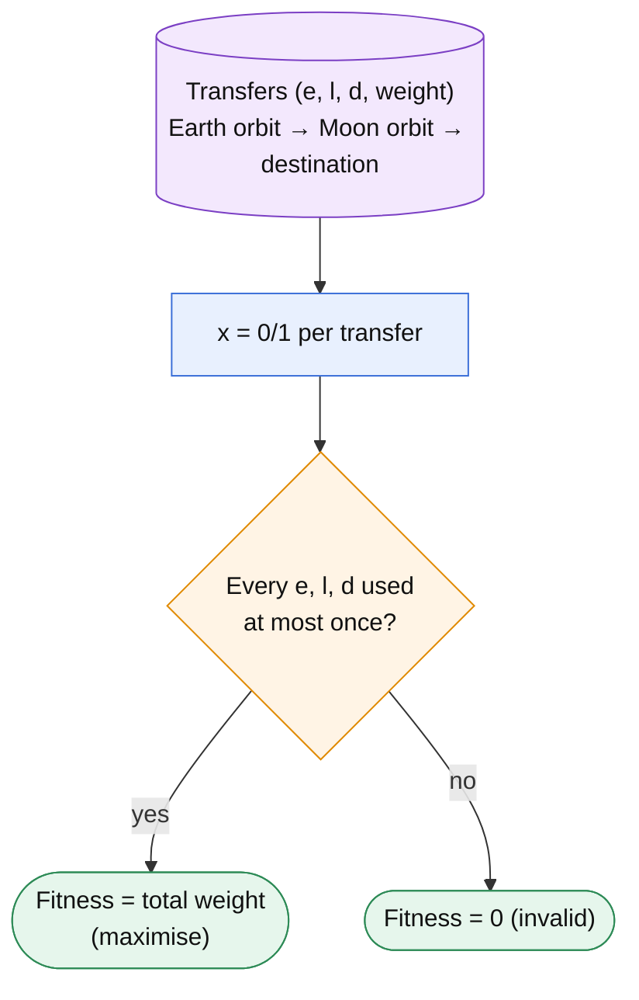
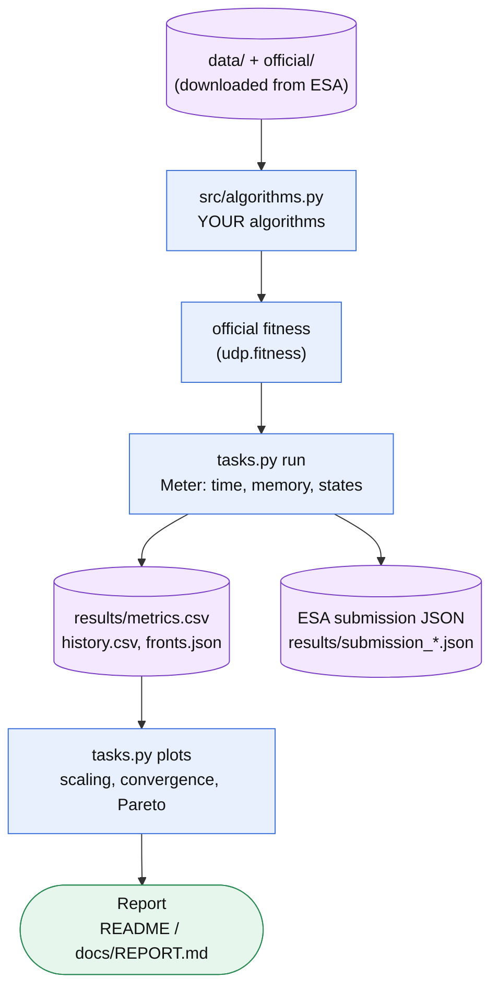

# VSI chat pack — Luna Tomato Logistics

> **For students using ChatGPT, Gemini or Claude in the browser or the app.**
> Upload this file to the chat and write: *"Read this file and guide me step by step."*
> SQ: Ngarkoje këtë skedar në chat dhe shkruaj: *"Lexo këtë skedar dhe më udhëhiq hap pas hapi."*

Project id (slug): `luna-tomato-logistics` · Source: https://optimise.esa.int/challenge/spoc-4-luna-tomato-logistics/About

## Instructions for the AI (read this first, follow it the whole conversation)

You are helping a university student with an **Algorithm Design & Analysis** project. The student may be a
beginner. **Reply in the student's language** (often Albanian). You cannot see their computer, so:

1. Work in **small steps**. Give the exact commands to copy, then **wait** for the student to paste the output.
2. Before the first command, ask which system they use. Use `python` on **Windows** and `python3` on
   **macOS / Linux** in every command you give.
3. When you write code, give the **complete content of one file** and its path (e.g. `src/algorithms.py`),
   never fragments to merge. After every change the student runs `python tasks.py test`.
4. The algorithms are the **student's own work**: explain the idea, pseudocode and complexity, keep the code
   simple and commented, and check they understand it (they must defend it in front of the professor).
   Do not import solver / optimisation libraries for the core algorithm.
5. Never invent results. Numbers in the report come from `results/metrics.csv`.

### Step 1 — set up the project (once)
1. Python 3.10 or newer: `python --version` (Windows) / `python3 --version` (macOS, Linux).
   If it is missing or older: install it from https://www.python.org/downloads/ (Windows: tick "Add to PATH").
2. Download VSI: https://github.com/andikuqi/vsi → **Code → Download ZIP**, unzip it.
3. Copy the folder **`vsi`** and the file **`AGENTS.md`** into the student's project folder
   (an empty folder or their existing GitHub repo).
4. Open a terminal **in the project folder** (Windows: in the folder, type `cmd` in the address bar and press
   Enter; macOS: right-click the folder → New Terminal at Folder; Linux: right-click → Open in Terminal) and run:
   ```
   python -m vsi new luna-tomato-logistics . --force
   python tasks.py start
   ```
   (`python3` instead of `python` on macOS / Linux.) `start` installs what is needed, downloads the data,
   runs the tests and a first run, makes charts, starts the report and prints **progress + the next step**.
   Ask the student to paste that output, then explain it in a few simple sentences.

### Step 2 — every work session
1. The student runs `python tasks.py context` and uploads the new **`CONTEXT.md`** (their current code,
   progress and results) to this chat.
2. Take the **next step** it shows (first open requirement), explain it, write the code, then:
   `python tasks.py test` → tick the requirement in `docs/REQUIREMENTS.md` → `python tasks.py report`.
3. Useful commands: `python tasks.py run` (experiments), `python tasks.py plots` (charts),
   `python tasks.py check` (progress + next step).

---

## The project (docs/PROBLEM.md)

## Problem: ESA SpOC 4 — Luna Tomato Logistics

Source: https://optimise.esa.int/challenge/spoc-4-luna-tomato-logistics/About
Official repo / discussions: https://github.com/esa/SpOC4
Single-objective · combinatorial (Beginner) + trajectory design (Advanced).

### Story in one line
Pick transfers Earth orbit → Moon orbit → Moon destination so that as many tomatoes as possible arrive,
with every orbit and destination used at most once.

### Problems
| Problem id | Level | Dimension | Data |
|---|---|---|---|
| `matching-i` | Beginner | 25 000 | `https://api.optimize.esa.int/data/spoc4/ltl/random_harder_5000.txt` (25 000 transfers) |
| `matching-ii` | Beginner | 92 103 | `https://api.optimize.esa.int/data/spoc4/ltl/random_hard_10000.txt` (92 103 transfers) |
| `trajectory-matching` | Advanced | 8 400 | `https://api.optimize.esa.int/data/spoc4/ltl/Earth_orbits.txt`, `Moon_orbits.txt`, `LTL.txt` |

### Beginner problems: weighted 3-dimensional matching
- Sets `E` (Earth orbits), `L` (Moon orbits), `D` (destinations), numbered `1, 2, …`.
- Input file: one transfer per line `e l d weight`, e.g. `1 1 1 6.202`.
- A solution is a set of transfers where no `e`, no `l` and no `d` is used twice.
- **Decision vector:** binary array of length |T|, `x[i] = 1` if transfer i is selected.
- **Fitness:** sum of the weights of the selected transfers (maximise; the board shows it negated).
  **Invalid solutions score 0.**
- Example (10 transfers): `[1,0,1,0,0,0,0,0,0,0]` → 8.843 valid; `[1,1,0,…]` invalid (destination 1 twice).

### Advanced problem: trajectory matching
- Transfer Earth orbit → Moon orbit is a rendezvous with at most 3 impulses in the bi-circular problem
  (Earth, Moon, Sun; Simó et al. 1995). Orbits are given by Keplerian `(a, e, i)` only.
- Delivered mass: `m_l = m_w · exp(-ΔV_tot / (Isp·g0)) - m_dry`, `m_w = 5000 kg`, `m_dry = 500 kg`, `Isp = 311 s`, `g0 = 9.80665`.
- Discount for time: `m_d = min(m_l, (200 - ΔT) · c_ld)`, `c_ld` = LTL rate (kg/day) from Moon orbit l to destination d,
  `ΔT` = transfer duration in days. Horizon 200 days.
- **Decision vector:** up to 400 transfers × 21 values = 8 400:
  `e_id, l_id, d_id, t0, x0, y0, z0, vx0, vy0, vz0, DVx0, DVy0, DVz0, DVx1, DVy1, DVz1, DVx2, DVy2, DVz2, T1, T2`.
  Unused slots: `e_id = -1`. Two-impulse transfer: set the middle impulse to 0.
- Orbit match tolerance `1e-6` on `a, e, i` (non-dimensional).

### Submission format
JSON file (one decision vector), uploaded at https://optimise.esa.int/submit:
```json
[
  {
    "decisionVector": [ x ],
    "problem": "matching-i",
    "challenge": "spoc-4-luna-tomato-logistics"
  }
]
```
Python: `from submission_helper import create_submission` (https://api.optimize.esa.int/data/tools/submission_helper.py), or `vsi.esa.write_submission`.

Problem ids: `matching-i`, `matching-ii`, `trajectory-matching`.

### Why it is hard
Maximum-weight 3-dimensional matching is **NP-hard** (one of Karp's problems; 2D matching is polynomial).
Classic course material: greedy by weight, local search with swaps, LP relaxation / Lagrangian bounds,
reduction to 2D matching as a heuristic. The Advanced problem adds expensive trajectory optimisation.

---

## Diagrams

### Problem model



### Project pipeline



---

## Requirements checklist (docs/REQUIREMENTS.md)

## Requirements checklist

Tick a box (`[x]`) only when it is done **and** verified. `python tasks.py check` reads this file.

### Problem & data
- [x] Problem statement copied from the official page (docs/PROBLEM.md)
- [ ] Official data + evaluation code downloaded and wired (`python tasks.py data`) <!-- auto:data -->
- [ ] Own instance parser (e l d weight) + validity checker written
- [ ] Own fitness = official fitness on sample solutions (including invalid → 0)
- [ ] Official example / sample solution evaluates to the expected value (test)

### Algorithms
- [ ] Baseline (random search) runs end to end with the official fitness <!-- auto:baseline -->
- [ ] Greedy by weight (sort transfers, add if no conflict)
- [ ] Improvement method (local search with 1-swap / 2-swap, simulated annealing or tabu)
- [ ] Upper bound for comparison (e.g. LP relaxation or best 2D matching) to measure the optimality gap
- [ ] (Optional) Advanced trajectory-matching problem
- [ ] At least one idea designed or modified by us (documented in DECISIONS.md)

### Analysis
- [ ] Pseudocode for every algorithm (README)
- [ ] Time & space complexity for every algorithm (README)
- [ ] Why the problem is hard / why heuristics are used
- [ ] Proof sketch / reference that weighted 3D matching is NP-hard

### Experiments
- [ ] Metrics recorded: fitness, runtime, peak memory, fitness evaluations <!-- auto:metrics -->
- [ ] Results on every problem instance
- [ ] Algorithm comparison table
- [ ] Convergence plot (best fitness over time) per problem
- [ ] Theory vs measured performance (scaling discussion)

### Delivery
- [ ] Submission JSON per problem, checked with the official fitness function
- [ ] README report complete (all sections filled)
- [ ] Defense preparation: can explain every algorithm and design decision
