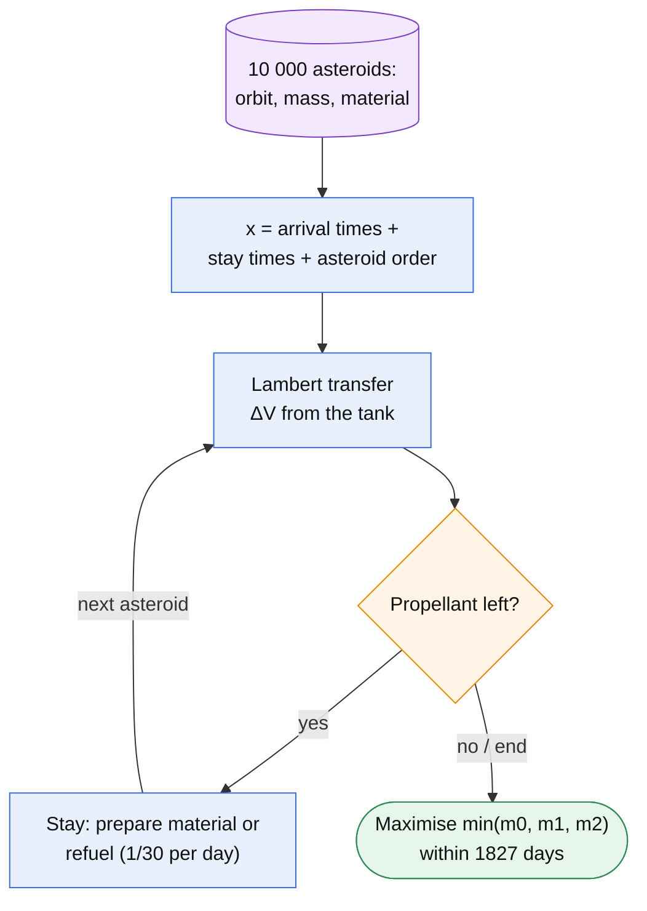
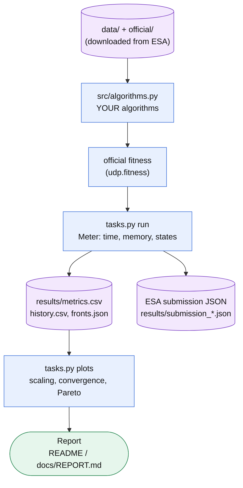

# VSI chat pack — Mining

> **For students using ChatGPT, Gemini or Claude in the browser or the app.**
> Upload this file to the chat and write: *"Read this file and guide me step by step."*
> SQ: Ngarkoje këtë skedar në chat dhe shkruaj: *"Lexo këtë skedar dhe më udhëhiq hap pas hapi."*

Project id (slug): `mining` · Source: https://optimise.esa.int/challenge/spoc-mining/About

## Instructions for the AI (read this first, follow it the whole conversation)

You are helping a university student with an **Algorithm Design & Analysis** project. The student may be a
beginner. **Reply in the student's language** (often Albanian). You cannot see their computer, so:

1. Work in **small steps**. Give the exact commands to copy, then **wait** for the student to paste the output.
2. Before the first command, ask which system they use. Use `python` on **Windows** and `python3` on
   **macOS / Linux** in every command you give.
3. When you write code, give the **complete content of one file** and its path (e.g. `src/algorithms.py`),
   never fragments to merge. After every change the student runs `python tasks.py test`.
4. The algorithms are the **student's own work**: explain the idea, pseudocode and complexity, keep the code
   simple and commented, and check they understand it (they must defend it in front of the professor).
   Do not import solver / optimisation libraries for the core algorithm.
5. Never invent results. Numbers in the report come from `results/metrics.csv`.

### Step 1 — set up the project (once)
1. Python 3.10 or newer: `python --version` (Windows) / `python3 --version` (macOS, Linux).
   If it is missing or older: install it from https://www.python.org/downloads/ (Windows: tick "Add to PATH").
2. Download VSI: https://github.com/andikuqi/vsi → **Code → Download ZIP**, unzip it.
3. Copy the folder **`vsi`** and the file **`AGENTS.md`** into the student's project folder
   (an empty folder or their existing GitHub repo).
4. Open a terminal **in the project folder** (Windows: in the folder, type `cmd` in the address bar and press
   Enter; macOS: right-click the folder → New Terminal at Folder; Linux: right-click → Open in Terminal) and run:
   ```
   python -m vsi new mining . --force
   python tasks.py start
   ```
   (`python3` instead of `python` on macOS / Linux.) `start` installs what is needed, downloads the data,
   runs the tests and a first run, makes charts, starts the report and prints **progress + the next step**.
   Ask the student to paste that output, then explain it in a few simple sentences.

### Step 2 — every work session
1. The student runs `python tasks.py context` and uploads the new **`CONTEXT.md`** (their current code,
   progress and results) to this chat.
2. Take the **next step** it shows (first open requirement), explain it, write the code, then:
   `python tasks.py test` → tick the requirement in `docs/REQUIREMENTS.md` → `python tasks.py report`.
3. Useful commands: `python tasks.py run` (experiments), `python tasks.py plots` (charts),
   `python tasks.py check` (progress + next step).

---

## The project (docs/PROBLEM.md)

## Problem: ESA SpOC — Mining the Belt

Source: https://optimise.esa.int/challenge/spoc-mining/About
UDP (evaluation code): https://api.optimize.esa.int/media/problems/spoc-mining-mine-the-belt-1647616672543.py
Single-objective · routing + scheduling (orienteering-like) · GECCO 2022.

### Story in one line
With one ship and a limited propellant tank, hop between asteroids of a belt in the TRAPPIST-1 system for 1 827 days,
preparing gold, platinum and nickel and refuelling on propellant asteroids, to maximise the scarcest material.

### Problem
Problem id: `mine-the-belt`. Data: `https://api.optimize.esa.int/data/spoc/mining/candidates.txt` (local `./data/spoc/mining/candidates.txt`),
10 000 asteroids, one per line:
`ID  a [m]  e  i [rad]  Ω [rad]  ω [rad]  true anomaly [rad]  mass [0..1]  material`
— material `0, 1, 2` = minable materials, `3` = propellant. `MU_TRAPPIST = G · 8.98266512e-2 · 1.989e30`.

### Rules
- Pick a start asteroid (does not count). Then repeatedly: next asteroid `a_i`, arrival time `t_i_arr ∈ [0, 1827]`,
  stay `t_i_m ∈ [1, 60]` days.
- Each day at an asteroid prepares / collects `1/30` mass (up to the asteroid's mass).
- Tank holds ΔV for 10 000 m/s; collecting 1.0 propellant mass refills it fully. Transfers are Lambert arcs (pykep).
- Running out of propellant ignores all later transfers. Only arrivals before day 1 827 count.

### Decision vector
`[t0_arr … tn_arr, t0_m … tn_m, a0 … an]`, made fixed-length (30 000) with `convert_to_chromosome`.

### Constraints
Each asteroid visited once (equality = 0); arrivals strictly increasing; `1 ≤ t_m ≤ 60` (inequalities ≤ 0).

### Objective (maximise; board shows `-J`)
`J = min(m0, m1, m2)` — the smallest prepared amount among the three materials.
The example chain on the official page (start 0, then 1446, 5131, 4449, 8091, 1516, 151, 4905, 8490) scores J = 0.58
(`udp.pretty(x)` prints the per-stop table).

### Submission format
JSON file (one decision vector), uploaded at https://optimise.esa.int/submit:
```json
[
  {
    "decisionVector": [ x ],
    "problem": "mine-the-belt",
    "challenge": "spoc-mining"
  }
]
```
Python: `from submission_helper import create_submission` (https://api.optimize.esa.int/data/tools/submission_helper.py), or `vsi.esa.write_submission`.

### Why it is hard
A time-dependent orienteering / prize-collecting TSP with a resource (propellant) constraint and a max-min objective,
over 10 000 nodes whose transfer costs change with time. Typical approach: precompute cheap transfer candidates
(nearby orbits), greedy / beam search choosing the next asteroid by material need and ΔV, then local search on the route.

---

## Diagrams

### Problem model



### Project pipeline



---

## Requirements checklist (docs/REQUIREMENTS.md)

## Requirements checklist

Tick a box (`[x]`) only when it is done **and** verified. `python tasks.py check` reads this file.

### Problem & data
- [x] Problem statement copied from the official page (docs/PROBLEM.md)
- [ ] Official data + evaluation code downloaded and wired (`python tasks.py data`) <!-- auto:data -->
- [ ] Own loader for candidates.txt + pykep installed for transfer costs
- [ ] The official example chain scores J = 0.58; own route simulator (propellant, mass, time) matches udp.pretty
- [ ] Official example / sample solution evaluates to the expected value (test)

### Algorithms
- [ ] Baseline (random search) runs end to end with the official fitness <!-- auto:baseline -->
- [ ] Neighbour pre-selection (cheap ΔV estimate between orbits) to shrink the 10 000 candidates
- [ ] Greedy / beam search route builder (balance materials, refuel when needed)
- [ ] Improvement method (insert / remove / swap asteroids, re-timing; SA or tabu)
- [ ] At least one idea designed or modified by us (documented in DECISIONS.md)

### Analysis
- [ ] Pseudocode for every algorithm (README)
- [ ] Time & space complexity for every algorithm (README)
- [ ] Why the problem is hard / why heuristics are used

### Experiments
- [ ] Metrics recorded: fitness, runtime, peak memory, fitness evaluations <!-- auto:metrics -->
- [ ] Results on every problem instance
- [ ] Algorithm comparison table
- [ ] Convergence plot (best fitness over time) per problem
- [ ] Theory vs measured performance (scaling discussion)

### Delivery
- [ ] Submission JSON per problem, checked with the official fitness function
- [ ] README report complete (all sections filled)
- [ ] Defense preparation: can explain every algorithm and design decision
