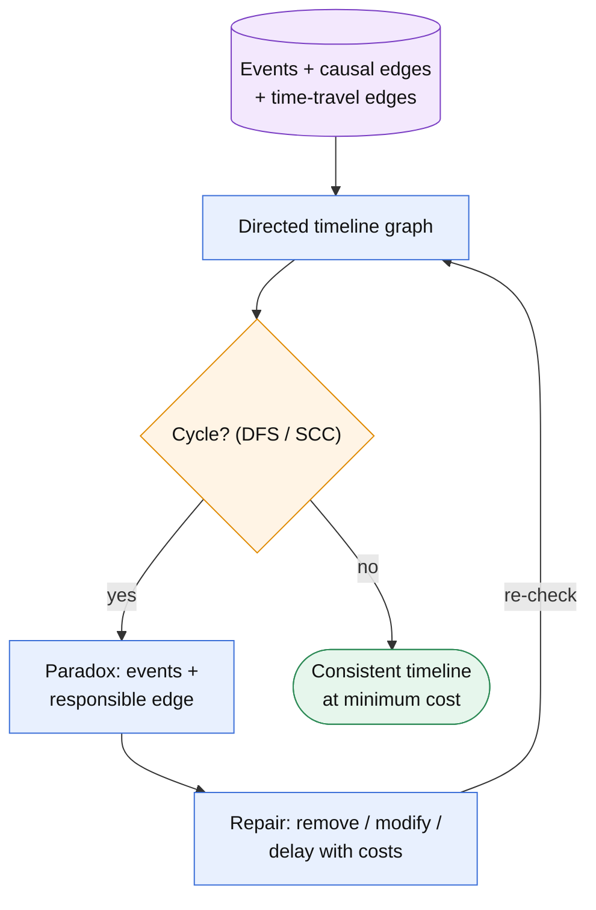
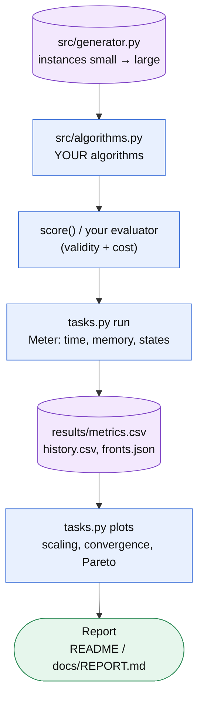

# VSI chat pack — Time Travel Paradox Detection and Timeline Optimization

> **For students using ChatGPT, Gemini or Claude in the browser or the app.**
> Upload this file to the chat and write: *"Read this file and guide me step by step."*
> SQ: Ngarkoje këtë skedar në chat dhe shkruaj: *"Lexo këtë skedar dhe më udhëhiq hap pas hapi."*

Project id (slug): `time-travel-paradox` · Source: professor brief (see PROBLEM.md)

## Instructions for the AI (read this first, follow it the whole conversation)

You are helping a university student with an **Algorithm Design & Analysis** project. The student may be a
beginner. **Reply in the student's language** (often Albanian). You cannot see their computer, so:

1. Work in **small steps**. Give the exact commands to copy, then **wait** for the student to paste the output.
2. Before the first command, ask which system they use. Use `python` on **Windows** and `python3` on
   **macOS / Linux** in every command you give.
3. When you write code, give the **complete content of one file** and its path (e.g. `src/algorithms.py`),
   never fragments to merge. After every change the student runs `python tasks.py test`.
4. The algorithms are the **student's own work**: explain the idea, pseudocode and complexity, keep the code
   simple and commented, and check they understand it (they must defend it in front of the professor).
   Do not import solver / optimisation libraries for the core algorithm.
5. Never invent results. Numbers in the report come from `results/metrics.csv`.

### Step 1 — set up the project (once)
1. Python 3.10 or newer: `python --version` (Windows) / `python3 --version` (macOS, Linux).
   If it is missing or older: install it from https://www.python.org/downloads/ (Windows: tick "Add to PATH").
2. Download VSI: https://github.com/andikuqi/vsi → **Code → Download ZIP**, unzip it.
3. Copy the folder **`vsi`** and the file **`AGENTS.md`** into the student's project folder
   (an empty folder or their existing GitHub repo).
4. Open a terminal **in the project folder** (Windows: in the folder, type `cmd` in the address bar and press
   Enter; macOS: right-click the folder → New Terminal at Folder; Linux: right-click → Open in Terminal) and run:
   ```
   python -m vsi new time-travel-paradox . --force
   python tasks.py start
   ```
   (`python3` instead of `python` on macOS / Linux.) `start` installs what is needed, downloads the data,
   runs the tests and a first run, makes charts, starts the report and prints **progress + the next step**.
   Ask the student to paste that output, then explain it in a few simple sentences.

### Step 2 — every work session
1. The student runs `python tasks.py context` and uploads the new **`CONTEXT.md`** (their current code,
   progress and results) to this chat.
2. Take the **next step** it shows (first open requirement), explain it, write the code, then:
   `python tasks.py test` → tick the requirement in `docs/REQUIREMENTS.md` → `python tasks.py report`.
3. Useful commands: `python tasks.py run` (experiments), `python tasks.py plots` (charts),
   `python tasks.py check` (progress + next step).

---

## The project (docs/PROBLEM.md)

## Time Travel Paradox Detection and Timeline Optimization

Source: professor's brief (condensed).

### Goal
Historical events and their causal dependencies form a directed graph. Time-travel actions add dependencies that
go backward in time and may create causal contradictions (paradoxes, e.g. the grandfather paradox).
Detect them, explain them, and repair the timeline with **minimum total modification cost**.

### Requirements
- Events as nodes, causal relations as directed edges; events have timestamp, location, affected entities,
  dependencies, consequences, importance/cost.
- Detect cycles and causal contradictions (topological sort, DFS/BFS, SCC, condensation, SAT/CSP…).
- Decide if a proposed time-travel sequence is valid; identify the events and dependency responsible.
- Repair operations with costs: remove / change / delay an event, prevent a time-travel action, branch a timeline.
- Find a consistent timeline with minimum cost (e.g. remove B = 10, remove E = 3, modify C = 5 → choose cheapest fix).
- Compare multiple approaches; complexity analysis; tests on increasingly complex timelines.

### Input
Number of events, timestamps, dependencies, time-travel operations, affected entities, modification costs,
constraints, maximum number of alternative timelines to explore.

### Output
Consistency verdict; detected paradoxes; events and dependency per paradox; repaired timeline; total repair cost;
alternative timelines explored; time; memory; metrics (paradoxes detected, events analysed, candidates explored,
minimum cost, scalability, % search space pruned).

### Note
Choosing a minimum-cost set of events/edges to break all cycles is a feedback vertex/arc set problem (NP-hard
in general) — justify exact methods for small inputs and heuristics/pruning for large ones.

### VSI starter
`src/generator.py` creates random timelines (forward DAG + time-travel back edges + costs) with a known number of paradoxes.

---

## Diagrams

### Problem model



### Project pipeline



---

## Requirements checklist (docs/REQUIREMENTS.md)

## Requirements checklist

### Implementation
- [ ] Timeline graph model (events, attributes, dependencies, time-travel edges)
- [ ] Generator / input parser for timelines of increasing size <!-- auto:data -->
- [ ] Cycle / contradiction detection (DFS, SCC, topological sort)
- [ ] Paradox explanation: events + responsible dependency
- [ ] Repair operations with costs
- [ ] Minimum-cost repair: exact method (small inputs)
- [ ] Minimum-cost repair: heuristic / pruned method (large inputs)
- [ ] Alternative timeline exploration with limit
- [ ] At least one idea designed or modified by us (DECISIONS.md)

### Analysis
- [ ] Pseudocode and complexity for every algorithm
- [ ] NP-hardness discussion of minimum-cost repair (feedback vertex/arc set)

### Experiments
- [ ] Metrics: paradoxes detected, events analysed, timelines explored, min cost, time, memory, % pruned
- [ ] Increasing timeline size
- [ ] Comparison of approaches, graphs and tables

### Delivery
- [ ] README report complete
- [ ] Defense preparation
