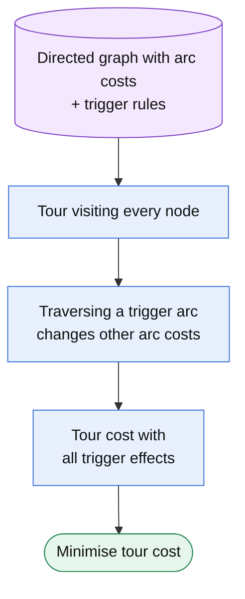
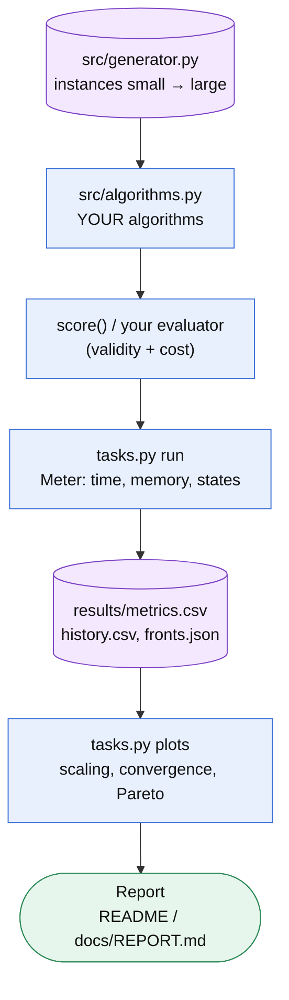

# VSI chat pack — The Trigger Arc TSP

> **For students using ChatGPT, Gemini or Claude in the browser or the app.**
> Upload this file to the chat and write: *"Read this file and guide me step by step."*
> SQ: Ngarkoje këtë skedar në chat dhe shkruaj: *"Lexo këtë skedar dhe më udhëhiq hap pas hapi."*

Project id (slug): `trigger-arc-tsp` · Source: ask the professor

## Instructions for the AI (read this first, follow it the whole conversation)

You are helping a university student with an **Algorithm Design & Analysis** project. The student may be a
beginner. **Reply in the student's language** (often Albanian). You cannot see their computer, so:

1. Work in **small steps**. Give the exact commands to copy, then **wait** for the student to paste the output.
2. Before the first command, ask which system they use. Use `python` on **Windows** and `python3` on
   **macOS / Linux** in every command you give.
3. When you write code, give the **complete content of one file** and its path (e.g. `src/algorithms.py`),
   never fragments to merge. After every change the student runs `python tasks.py test`.
4. The algorithms are the **student's own work**: explain the idea, pseudocode and complexity, keep the code
   simple and commented, and check they understand it (they must defend it in front of the professor).
   Do not import solver / optimisation libraries for the core algorithm.
5. Never invent results. Numbers in the report come from `results/metrics.csv`.

### Step 1 — set up the project (once)
1. Python 3.10 or newer: `python --version` (Windows) / `python3 --version` (macOS, Linux).
   If it is missing or older: install it from https://www.python.org/downloads/ (Windows: tick "Add to PATH").
2. Download VSI: https://github.com/andikuqi/vsi → **Code → Download ZIP**, unzip it.
3. Copy the folder **`vsi`** and the file **`AGENTS.md`** into the student's project folder
   (an empty folder or their existing GitHub repo).
4. Open a terminal **in the project folder** (Windows: in the folder, type `cmd` in the address bar and press
   Enter; macOS: right-click the folder → New Terminal at Folder; Linux: right-click → Open in Terminal) and run:
   ```
   python -m vsi new trigger-arc-tsp . --force
   python tasks.py start
   ```
   (`python3` instead of `python` on macOS / Linux.) `start` installs what is needed, downloads the data,
   runs the tests and a first run, makes charts, starts the report and prints **progress + the next step**.
   Ask the student to paste that output, then explain it in a few simple sentences.

### Step 2 — every work session
1. The student runs `python tasks.py context` and uploads the new **`CONTEXT.md`** (their current code,
   progress and results) to this chat.
2. Take the **next step** it shows (first open requirement), explain it, write the code, then:
   `python tasks.py test` → tick the requirement in `docs/REQUIREMENTS.md` → `python tasks.py report`.
3. Useful commands: `python tasks.py run` (experiments), `python tasks.py plots` (charts),
   `python tasks.py check` (progress + next step).

---

## The project (docs/PROBLEM.md)

## The Trigger Arc TSP

Source: **not provided in the assignment list** (only the title). Ask the professor for the official problem
statement and instances, then replace this file with it.

### What it usually means (verify!)
A Traveling Salesperson variant on a directed graph where traversing certain "trigger" arcs changes the cost
of other ("target") arcs later in the tour. The goal is a Hamiltonian tour of minimum total cost, taking those
cost changes into account. Like the TSP it is NP-hard, so exact methods (e.g. B&B, ILP) only scale to small
instances and heuristics/metaheuristics are needed for large ones.

### VSI starter
Generic template (measurement, experiments, plots, report). Add a loader once you have the official instances.

---

## Diagrams

### Problem model



### Project pipeline



---

## Requirements checklist (docs/REQUIREMENTS.md)

## Requirements checklist

- [ ] Official problem statement and instances obtained (replace PROBLEM.md)
- [ ] Instance loader + solution evaluator (tour cost with trigger effects), with tests
- [ ] Baseline (e.g. nearest neighbour)
- [ ] Improvement method (2-opt / local search / SA / GA)
- [ ] Exact or bounded method for small instances (optional)
- [ ] Pseudocode and complexity for every algorithm
- [ ] Experiments: cost, time, memory, scaling, comparison
- [ ] README report complete
- [ ] Defense preparation
